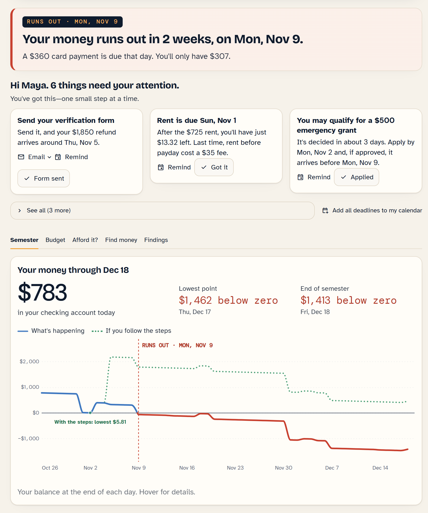
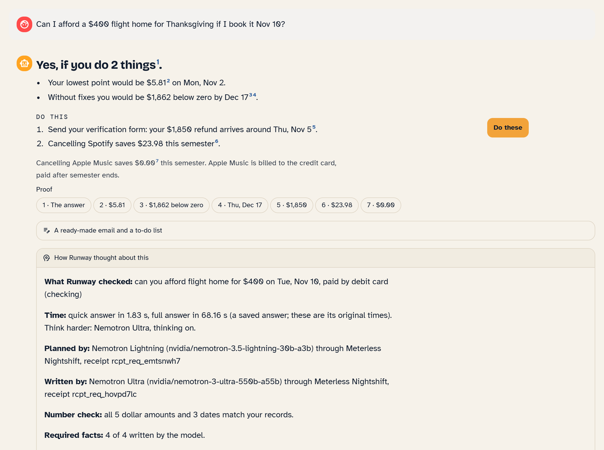
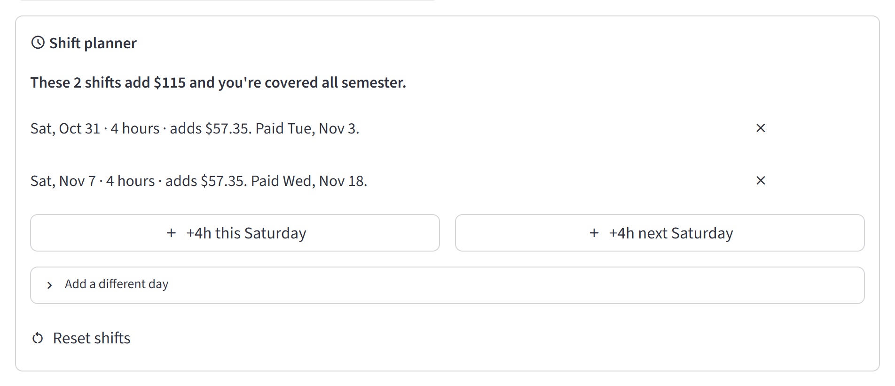
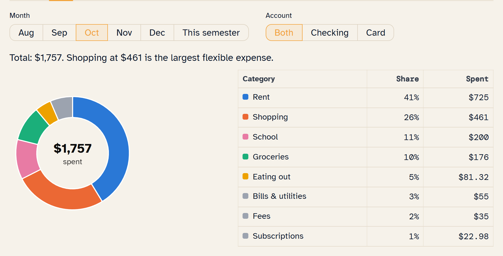
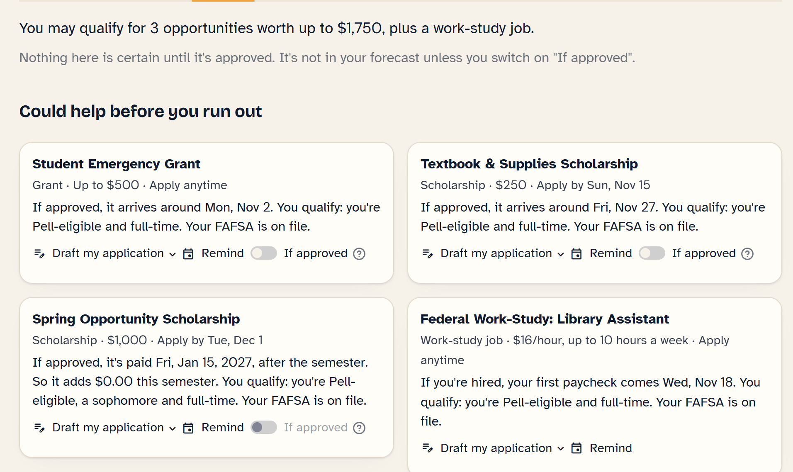
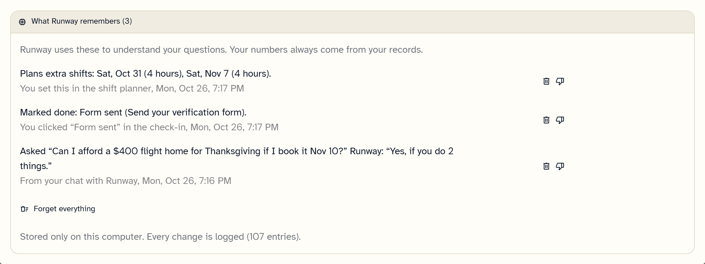
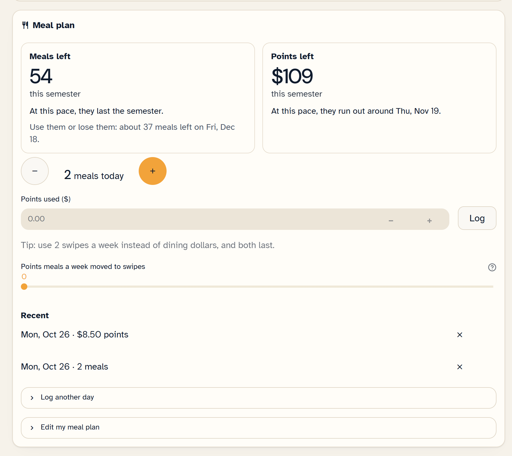
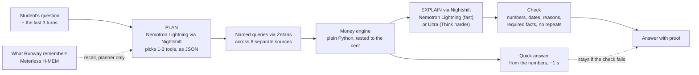

# Runway

**An AI money agent for college students that tells you how long your money lasts, and explains why, with proof.**

**Live demo:** [LIVE DEMO LINK](https://LIVE-DEMO-LINK.streamlit.app) (sample mode: recorded answers, made-up student data; see [docs/DEPLOY.md](docs/DEPLOY.md))

> **Run it in 2 minutes. No keys needed** (sample mode; tested on Python 3.13 and 3.14):
> `git clone https://github.com/earg555890/Runway-GenAi-10.27 runway && cd runway` · `pip install -r requirements.txt` · `streamlit run ui/app.py`
> Step by step for macOS, Linux and Windows: [Try it in 2 minutes (sample mode)](#try-it-in-2-minutes-sample-mode).

Built for the GenAI Works Open Agent Hackathon (HackOS), track: **The Agent That Can Explain Why**.

Built on **Zetaris** (the data layer), **Meterless** (Nightshift as the AI provider, and the H-MEM memory engine)
and **NVIDIA Nemotron** (through Nightshift).

## The problem

A student's money is split across six places that never talk to each other: a bank account, a credit card, a financial aid award, the school's student account (bursar), a lease and a part-time job. Each one looks fine on its own. Together they hide surprises: a refund held for a missing form, rent landing the day before payday, an overdraft fee, a card bill that falls due right after a big purchase. Students find out when the money is already gone.

## What Runway does

Runway connects eight separate sources (checking, card, financial aid, student account, lease, work schedule, the school's aid opportunities and the meal plan), projects the checking balance day by day to the end of the semester, and answers plain questions. Every answer shows its proof.

**It speaks up first.** Under the status card, a check-in says "Hi Maya. 6 things need your attention." and shows the three most urgent as cards (most money at stake per day until it's due): send the verification form (her $1,850 refund then arrives around Thu, Nov 5), rent on Sun, Nov 1 leaves just $13.32 (rent before payday cost a $35 fee last time), and the $500 emergency grant to apply for; "See all" has the tight tuition week, the duplicate music apps and the meal plan. The run-out date itself is the status card right above, so it isn't repeated as a card. Each card has real actions, and every one is a click by the student:

- **Remind:** a calendar file (.ics) for that deadline, or "Add all deadlines to my calendar" as one file.
- **Email:** opens the drafted email to financial aid in her email app (a `mailto:` link), or copy it. The address is a demo one (`finaid@stateu.example`).
- **Cancel page:** opens the service's official cancel page (Spotify's account page; for Apple Music, Apple's help page).
- **Mark as done:** "Form sent" or "Cancelled Spotify" turns that fix on in the forecast right away (the status card, chart and check-in update) and Runway says what changed in the chat; Undo puts it back. Behind the scenes keeps a log of what Runway prepared and what she approved.

Ask "What should I do this week?" and the answer comes with the same buttons.

**Find money tab.** The school's grants, scholarships and work-study (a separate source), checked against Maya's profile by plain rules: "You may qualify for 3 opportunities worth up to $1,750, plus a work-study job." Cards are grouped by when the money would arrive if approved: the $500 emergency grant (decided in about 3 business days; applying Tue, Oct 27 it would arrive Mon, Nov 2, before she runs out), a $250 book scholarship (Fri, Nov 27), a $1,000 spring scholarship that pays in January (so $0.00 this semester, the same timing lesson as Apple Music), work-study (first paycheck Wed, Nov 18), and the merit scholarship she just misses (3.50 GPA needed, hers is 3.40). Each card drafts the application, sets a reminder, and has an "If approved" switch that adds it to the forecast as a clearly labelled what-if. Grants are never counted as certain money and never used as a fix in "Afford it?".

**My college, jobs near campus and school costs (Find money tab).** "My college" holds her college, its city, on or off campus, and how far she can travel for work. It is saved on this computer (`.cache/college.json` for Maya, `user_data/college.json` in My data mode, both gitignored) and remembered in "What Runway remembers" ("You attend ... in ..."). Maya starts with her made-up demo school; My data mode starts empty. "Jobs near campus" searches the web (the same search and guardrails as the scholarships) and lists each job page with its title, site, place, pay and hours. It shows pay and hours only when the page states exactly one of each, and labels the list "Found online, check before applying". "What if I got this job?" takes the pay, hours, start date and pay schedule she confirms. The engine then shows when the first paycheck arrives (each pay period is paid the Friday after it ends), whether that's before she runs out, and the new lowest point and run-out date. For Maya, $15/hour at 10 hours a week from Mon, Nov 2 pays first on Fri, Nov 20, after she runs out on Mon, Nov 9. Her lowest point becomes $907 below zero instead of $1,462. Nothing enters the forecast until she clicks "Add to my plan". "Look up my school's published costs" finds the school's cost-of-attendance page (a .edu page first). It shows each tuition, fees, housing or meals line exactly as written, with the link and the academic year. She ticks, edits and dates each amount before "Use these as my estimates". Estimates go into the forecast clearly labelled ("estimated from <school>'s published costs, check your bill") only when there is no real school bill; her real bursar bill always wins. In the chat, "Find me a job near campus" cites the job pages as web links, never as her records. "Would a $15/hour job at 10 hours a week help?" answers with the first paycheck date, before or after the run-out date, and the new lowest point. Online search is off in sample mode and in the offline demo.

**Found online - check before applying.** Under the school's list, Runway also shows scholarships and emergency grants found on the web (Firecrawl search, no key needed): title, site and link, and an amount or deadline only when that exact text is on the page, otherwise "see website". Runway never says she qualifies for these, and they are never in the forecast. "Search online now" refreshes them in the background; replay mode uses a set saved on Oct 25 (`demo_answers/web_scholarships.json`). In the chat: "Find me scholarships online".

**Meal plan.** A card in the Semester tab (and the check-in): her dining dollars run out around Sun, Nov 22, but she'll have about 40 swipes to spare on Dec 18, so checking pays $0.00. Moving 2 dining-dollar meals a week to swipes makes both last. The card shows two big counters ("Meals left", "Points left") with their reset or run-out day. A "+" / "-" button logs or undoes a meal today in one tap; points get a "Log" box; the last 5 entries can be removed. "Edit my meal plan" sets meals and points per day, week or semester, roll-over, the week's reset day and the plan dates; "Reset to my school's plan" goes back to the demo plan. Settings and the log stay on this computer (`.cache/mealplan.json` for Maya, `user_data/mealplan.json` in My data mode, both gitignored). If her pace runs a plan short, the estimated extra meal cost goes into the forecast. In the chat, "I just used 2 meals" shows what would be left and a "Log 2 meals" button; nothing is logged until she taps it.

**Budget tab.** One sentence on where the money went ("So far in October, you spent $1,757. Most went to Rent ($725) and Shopping ($461)."), a donut of the top categories with the total in the middle, and a table whose rows open the purchases behind each category. Month (Aug to Dec, or this semester) and account filters. Below it, "Your budget for November" starts from what's left after rent and bills: for Maya that's $487 short until her refund comes, and $1,363 once the verification form is sent. "Suggest a budget" fills in her usual spending (Shopping $227, Groceries $185, Eating out $96, Transportation $14), scaled down if it doesn't fit; progress bars show this month's pace; and "Use my budget in my forecast" puts the budget into the balance forecast, so the status card and chart show how long the money lasts if she sticks to it. Ask "How much is left in my food budget?" or "What happens if I stick to my budget?" in the chat.

**My data: use your own bank export.** Switch the header to "My data" and upload a CSV from your bank. Runway detects the columns, the date format and how money out is shown (a minus sign, parentheses, or separate debit and credit columns), shows a preview with dropdowns to fix anything, and rejects files it can't read in plain words. Then the whole app runs on your file: the balance today, your pay and bills found from the history, how long the money lasts, the budget and the chat. School features say "Connect your school data to see this." Your file stays on this computer (`user_data/`, never committed), and your answers are never saved.

The demo student is Maya (fictional). Today is Mon, Oct 26, 2026; the semester ends Fri, Dec 18.

| Suggested question | What Runway answers |
|---|---|
| Can I afford a $400 flight home for Thanksgiving if I book it Nov 10? | **Yes, if you do 2 things:** send the verification form (releases a held $1,850 refund around Thu, Nov 5) and cancel Spotify. Cancelling Apple Music saves $0.00, because its next charge is paid on a card bill due after the semester. |
| How long will my money last? | **Your money runs out on Mon, Nov 9**, when a $360 card payment is due. |
| Where is my money leaking? | Two music subscriptions and a $35 overdraft fee from rent, and which of them is worth cancelling. |
| Can I afford a $400 flight home for Thanksgiving? | **Not right now:** with no date, Runway assumes tomorrow, before the refund arrives, and says so. |
| What should I do this week? | **2 things:** send the verification form (the $1,850 refund then arrives around Thu, Nov 5), and keep $725 in checking for rent on Sun, Nov 1, with the same buttons as the check-in. |

**Ask anything about your money, in a chat with follow-ups.** Beyond the suggested questions, Runway answers spending ("How much did I spend on eating out in October?", "How much did I spend at Kroger?"), bills ("What's due next week?"), work ("How many hours did I work in October?"), balances on a date ("What will my balance be on Thanksgiving?"), what's pending today, ways to get money before you run out, and general questions ("What is FAFSA verification?", labelled General info). Follow-ups work: "what about Nov 17 instead?", "why?", "and if I also cancel Apple Music?". A broad request like "Help me get through the semester" runs several checks at once.

- **Fast:** a quick answer built from your numbers appears in about a second; the AI's explanation replaces it a few seconds later, only if it passes the checks. "Think harder" switches to the larger model and shows its reasoning.
- **What-if panel:** turn fixes on and off (send the form, cancel a subscription) and the balance chart and numbers update instantly, with no AI call.
- **Shift planner:** try the extra shifts you're thinking of taking ("+4h this Saturday", or any day and hours). Each shift shows its pay after withholding and its payday, in time or after you run out; the total says how much longer the money lasts ("These 2 shifts add $229 and your money lasts until Sun, Nov 15 (6 days longer)."). "Reset shifts" clears them. In the chat, "What if I work 4 hours this Saturday and next Saturday?" answers the same way, with a button to add them to the planner.
- **Drafted actions:** a ready-to-send email to the financial aid office, calendar reminders and a to-do list. Runway never sends anything; you approve every action with a click.
- **What Runway remembers (Meterless H-MEM):** what you marked done, what you opened (the email draft, a reminder), your budget, the shifts you plan and short notes from your chats, each with where it came from and when. In your next session the check-in picks up where you left off ("Last time you clicked "Form sent". Still true? Click it again."), and follow-up questions across sessions work. Memory helps Runway understand your question; the numbers in an answer still come only from your records. Forget one memory, mark it "not right", or forget everything.

## Sample inputs and outputs

Real answers, recorded on Oct 26, 2026 through Meterless Nightshift by `nvidia/nemotron-3-ultra-550b-a55b` (Think
harder). Each passed every check on the first try. They are the files in `demo_answers/` that sample mode replays,
and each one carries its Meterless receipt id. `[C#]` marks a citation; in the app each becomes a proof chip that
opens the calculation and the source rows.

**1. "Can I afford a $400 flight home for Thanksgiving if I book it Nov 10?"** (receipt `rcpt_req_hovpd7lc`, 68 s)

```text
ANSWER: Yes, if you do 2 things [C1].
WHY:
- Your lowest point would be $5.81 [C4] on Mon, Nov 2.
- Without fixes you would be $1,862 below zero by Dec 17 [C2][C3].
DO THIS:
1. Send your verification form: your $1,850 refund arrives around Thu, Nov 5 [C6].
2. Cancelling Spotify saves $23.98 this semester [C8].
NOTE: Cancelling Apple Music saves $0.00 [C7] this semester. Apple Music is billed to the credit card, paid after semester ends.
```

**2. "Can I afford a $400 flight home for Thanksgiving?"** (no date; receipt `rcpt_req_sgkdv326`, 105 s)

```text
ANSWER: Not right now [C1].
WHY:
- Your lowest point would be $394 below zero [C4] on Mon, Nov 2.
- Without fixes you would be $1,862 below zero by Thu, Dec 17 [C2][C3].
DO THIS:
1. Submit the verification form to release the $1,850 refund by Thu, Nov 5 [C6].
2. Cancel Spotify to save $23.98 this semester [C8].
NOTE: You didn't say when you'd buy it, so I assumed tomorrow, Tue, Oct 27. Cancelling Apple Music saves $0.00 [C7] this semester: Apple Music is billed to the credit card, and that card bill is paid after the semester ends.
```

**3. "How long will my money last?"** (receipt `rcpt_req_e11u9i51`, 40 s)

```text
ANSWER: Your money runs out on Mon, Nov 9 [C4].
WHY:
- A $360 card payment [C1] is due Mon, Nov 9, when you'll have $307.
- The lowest balance later is $1,462 below zero on Thu, Dec 17 [C2][C3].
DO THIS:
1. Track daily spending to stay above zero.
2. Plan for the $360 card payment on Mon, Nov 9.
NOTE: Next paycheck arrives Tue, Nov 3 [C13].
```

**4. "Where is my money leaking?"** (receipt `rcpt_req_9215k3eu`, 18 s)

```text
ANSWER: You have two music subscriptions and an overdraft fee from rent.
WHY:
- You pay for Apple Music [C3].
- You pay for Spotify [C3].
- Together they cost $22.98 a month [C3].
- Rent caused a $35 overdraft fee [C9].
DO THIS:
1. Cancel Spotify to save $23.98 by Dec 18 [C7].
2. Set a reminder to pay rent before the 1st to avoid fees [C13].
NOTE: Apple Music charges your card, so canceling it doesn't help checking until after the semester [C6].
```

How Runway reached answer 1, step by step (plan, queries, model calls with routed model and receipt, checks):
[docs/example_trace.json](docs/example_trace.json).

## Watch the demo

Video: *coming soon* (link to be added)

## Screenshots

Maya's demo data.

| | |
|---|---|
|  |  |
| **It speaks up first:** the status card and the check-in, then the graph: what's happening (solid) and if you follow the steps (dotted). | **Ask Runway** (the round button, bottom-left): every number cited, and which model answered, through Meterless Nightshift. |
|  |  |
| **Shift planner:** each shift's pay and payday. | **Budget:** where the money went, by category. |
|  |  |
| **Find money:** the school's grants, "if approved" only. | **What Runway remembers** (Meterless H-MEM): each memory with where it came from. |
|  | |
| **Meal plan:** meals and points per day, week or semester; one tap logs a meal. | |

## Dependencies

| Dependency | What it does in Runway | Needed for |
|---|---|---|
| Python 3.11+ and `requirements.txt` (Streamlit, openai, JayDeBeApi, pytest) | the app, the agent, the engine and the tests | everything |
| **Zetaris** (local Docker bundle, Lightning JDBC) + Java 21 | the data layer: 8 Lightning databases, 21 named queries, a federated query | full mode (`DATA_BACKEND=zetaris`) |
| **Meterless Nightshift** (Windows edition), the Meterless Runtime at `http://127.0.0.1:8088/v1` | the primary AI provider (OpenAI-compatible); the NVIDIA key is set inside Nightshift | full mode (live answers) |
| **NVIDIA Nemotron**, through Nightshift: `nvidia/nemotron-3.5-lightning-30b-a3b`, `nvidia/nemotron-3-ultra-550b-a55b` | plans the tools and writes the answers | full mode (live answers) |
| Meterless **H-MEM** | Runway's memory (`hmem.py`, a Python port of the reference) | built in, no setup |

Sample mode needs only Python: no Zetaris, no Nightshift, no keys.

## Try it in 2 minutes (sample mode)

No keys needed. Sample mode (`SAMPLE_MODE=true`, the default in `.env.example`, and also on when there is no `.env`
at all) runs the full app on Maya's included data, with recorded AI answers for the suggested questions, and calls
no AI provider. Needs Python 3.11 or newer and git.

**macOS / Linux**

```bash
git clone https://github.com/earg555890/Runway-GenAi-10.27 runway && cd runway
python3 -m venv .venv && .venv/bin/pip install -r requirements.txt
cp .env.example .env
.venv/bin/streamlit run ui/app.py
```

**Windows (PowerShell)**

```powershell
git clone https://github.com/earg555890/Runway-GenAi-10.27 runway; cd runway
py -m venv .venv; .venv\Scripts\pip install -r requirements.txt
copy .env.example .env
.venv\Scripts\streamlit run ui/app.py
```

On Windows, clone into a short folder (like `C:\code`): one package installs files with very long paths, and pip fails past Windows' 260-character limit.

Then open http://localhost:8501 and click a suggested question. Typed questions need full mode (below).

On Windows, after the install you can also double-click **Start Runway.bat** (opens the browser; does nothing extra if Runway is already running), **Start Runway (Zetaris).bat** and **Stop Runway.bat**. For recording the demo video, **Start Runway (Live demo).bat** checks the NVIDIA endpoint with one real question (`demo_check.py`), uses Zetaris if it's up, moves saved answers aside and starts Runway in live mode (every answer generated live); see [docs/DEMO_SCRIPT.md](docs/DEMO_SCRIPT.md).

## Full mode (Zetaris + Meterless Nightshift)

1. **Meterless Nightshift:** install and open Nightshift (Windows edition). In **Setup > Providers**, add your NVIDIA key (from [build.nvidia.com](https://build.nvidia.com)). The key stays in Nightshift, not in Runway. From Nightshift's Console (**Setup > Runtime**), copy the Runtime URL and token into `.env`: `METERLESS_BASE_URL=http://127.0.0.1:8088/v1` and `METERLESS_RUNTIME_TOKEN=...`. Leave the token empty and Runway reads the runtime's own `proxy-token` file.
2. **Zetaris:** start the Zetaris Docker bundle, fill in the `ZETARIS_*` settings and `JAVA_HOME` in `.env`, and load the data with `python load_zetaris.py`.
3. In `.env`: `SAMPLE_MODE=false`, `DATA_BACKEND=zetaris`, and `ANSWER_MODE=cached` (saved answers first, then live) or `live`. Restart the app.

Behind the scenes > **AI provider** shows the Nightshift checks (connection, authorization, model discovery, a real text request). Every answer says which model wrote it, with the Meterless receipt. The first Zetaris load runs every query (about a minute on our laptop) and caches the results. If Nightshift isn't reachable and an `NVIDIA_API_KEY` is set, Runway calls NVIDIA directly and labels the answer "fallback". More in [docs/DEVELOPMENT.md](docs/DEVELOPMENT.md).

## How it works



Trust rules:

- **All math is in code.** The AI never adds, subtracts or projects anything; the engine computes every number before the AI writes a word.
- **Every number is cited.** Each sentence points to a calculation or a source record, and the app shows the rows behind it.
- **A checker reads every answer.** Each dollar amount and date must match the computed results, and the answer must include the facts that matter (like the run-out date). It also checks the reasons: a store or subscription it names must be in the evidence, "charged to your card" must be true, and "saves $X" must match the computed saving. Repeated sentences, cut-off answers and made-up budgets fail too. On a miss, the AI gets one rewrite; if it still fails, the quick answer built from the numbers stays.
- **No internal IDs leak into answers.** Record IDs stay in the proof view, not in the text.
- **It degrades gracefully.** At most two AI calls per question (plus one rewrite). If one model is down, the other writes; if both are down, the quick answer stands. If Zetaris is down, the app runs on the local copy of the data and says so.
- **Memory never supplies numbers.** Runway's memory (H-MEM) goes to the planner only. The answer is written from the evidence pack alone. This matters: Nightshift runs its own H-MEM and injected old answers into new requests (its receipt says `"hmem": injected 2`), and Runway's checker rejected every answer that reused those numbers.

## Sponsor technology

- **Zetaris:** federated data access over JDBC (Lightning SQL). Each source is its own Lightning database, 8 in all: `RUNWAY_CHECKING`, `RUNWAY_CARD`, `RUNWAY_AID`, `RUNWAY_BURSAR`, `RUNWAY_LEASE`, `RUNWAY_SHIFTS`, `RUNWAY_OPPORTUNITIES` and `RUNWAY_MEALPLAN`, read through 21 named queries (the app never runs ad-hoc SQL). The federated query `federated_recurring_charges` spans two of those databases in one statement, the checking account and the credit card (`UNION ALL` + `GROUP BY ... HAVING`), to find charges that repeat every month. The app has a "Run live on Zetaris" button that runs it uncached, with a timer and the SQL. An uploaded bank file (My data) can be registered as a ninth database, `RUNWAY_MYDATA`, on the same computer.
- **Meterless Nightshift: the primary AI provider.** Every model call goes through the Meterless Runtime (OpenAI-compatible, on this computer), following the official provider contract (Meterless Runtime 0.90.0): Bearer runtime token, `meterless-app: runway` on every request, `meterless-scope: user` on chat, discovery and status from `GET /v1/models`, Auto Detect, a 180 s timeout (`llm_client.py`, `meterless.py`). Each answer records the routed model and the receipt from `meterless.compute_receipt.v1`, shown in "How Runway thought about this" and in the traces.
- **Meterless H-MEM: Runway's memory.** `hmem.py` ports the H-MEM reference to Python: provenance on every record, short-term / working / long-term layers, the hybrid retrieval formula, the append-only trust ledger, feedback, conflicts, sleep and dreaming. It passes the official conformance vectors (13/13). It powers "What Runway remembers" (see above).
- **NVIDIA Nemotron, through Nightshift:** PLAN (`nvidia/nemotron-3.5-lightning-30b-a3b`, thinking off) picks up to three tools and their arguments as JSON, and resolves follow-ups. EXPLAIN writes the answer: Lightning with thinking off by default (a few seconds), or `nvidia/nemotron-3-ultra-550b-a55b` with thinking on in "Think harder" mode, where its reasoning trace is shown in the app.

Full sponsor write-up: [docs/SPONSOR_TECH.md](docs/SPONSOR_TECH.md). Machine-readable summary: [metadata.json](metadata.json).

## Traces and tests

- **How the agent reached each answer:** every question answered live writes one JSON line to `logs/traces.jsonl` (gitignored): the plan, each tool and query (source, backend, rows, time), the memories recalled for the planner, every model call (provider, requested and routed model, Meterless receipt id, time), timings and the check results. A committed example for Maya's flight question: [docs/example_trace.json](docs/example_trace.json).
- **The Meterless engine test:** `python -m pytest tests/test_hmem_conformance.py tests/test_runway_memory.py` runs the official H-MEM conformance vectors (unchanged from the Meterless repo, with a pytest port of `runner.ts`): **13/13 pass**, plus 8 tests of the memory feature.
- **Everything:** `python -m pytest` (Zetaris tests are skipped when Zetaris isn't running).

## Results

We asked Runway 29 realistic student questions with the live NVIDIA models (Oct 26, 2026, on NVIDIA's API directly, before the switch to Nightshift; Think harder used Nemotron Super then): twice in fast mode and once in "Think harder" mode. A full answer means the right tool, the right verdict, every amount and date matching the records, and every required fact written by the model.

- **Think harder** (Nemotron Super, thinking on): **28/29 full answers**, about a minute each.
- **Fast** (Nemotron Lightning, the default): **48/58 full answers**, about 3 seconds each. The quick answer from the engine shows in under a second.
- **Every shown answer passed the number check (87/87).** When the AI's answer failed, Runway showed the quick answer built from the engine instead.

Details, every question and what went wrong: [eval_summary.md](eval_summary.md).

## Data

All demo data is synthetic. Maya Rivera is fictional, and no real bank, card, school or employer account is connected. Her files are in `data/maya/`, generated by `generate_maya_data.py`. The test bank files in `tests/fixtures/fake_bank/` are fake too. A file you upload in My data mode stays on your computer in `user_data/` (gitignored), is never committed, cached, remembered or traced by Runway, and is sent nowhere except to the AI provider (Meterless Nightshift on this computer, which forwards to NVIDIA) for answers you ask for. Nightshift keeps its own local log of requests (and its own memory) on this computer, so My data mode shows a notice above the chat: "Your questions go through Meterless Nightshift on this computer, which keeps a local log of requests."

## Roadmap

Built already: upload your own bank export (My data). Next:

1. **Bank connections with consent, through an aggregator.** Not built in a 6-day build: it needs the aggregator's approval, a security review, and real consent and privacy work, so the CSV upload covers this for now.
2. **School integrations (financial aid, student account, meal card), through university partnerships.** Not built in a 6-day build: there are no standard APIs for aid or bursar accounts, so each school needs its own agreement.
3. **Verified scholarship databases,** so "Found online" results can say who qualifies, with checked amounts and deadlines.
4. **A mobile app,** with the check-in as a weekly notification.

---

Developer notes (setup, tests, evaluation, Zetaris loading): [docs/DEVELOPMENT.md](docs/DEVELOPMENT.md).
