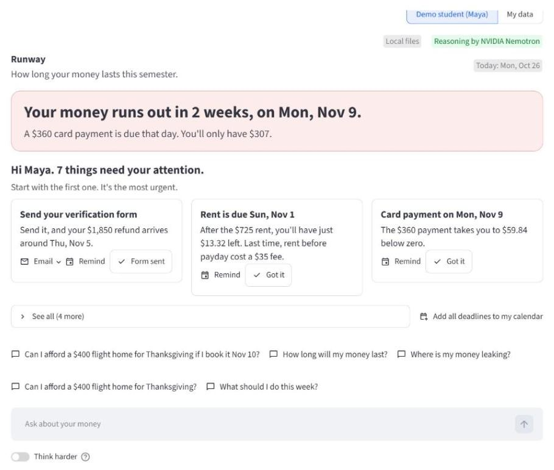
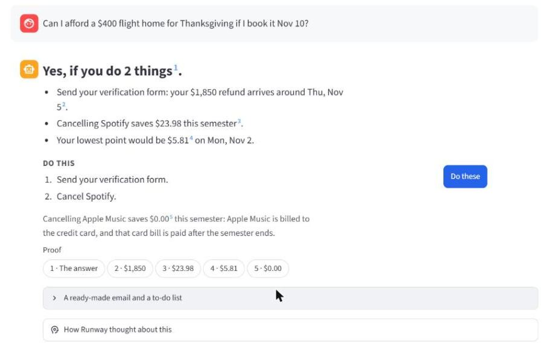
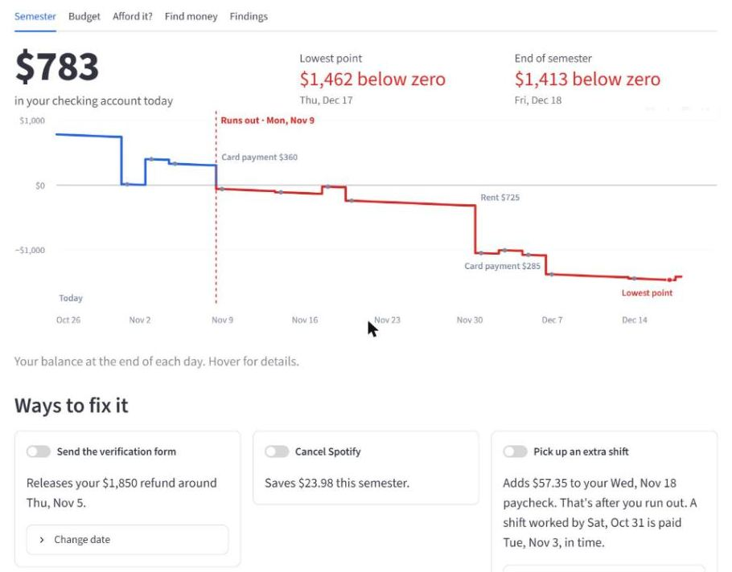
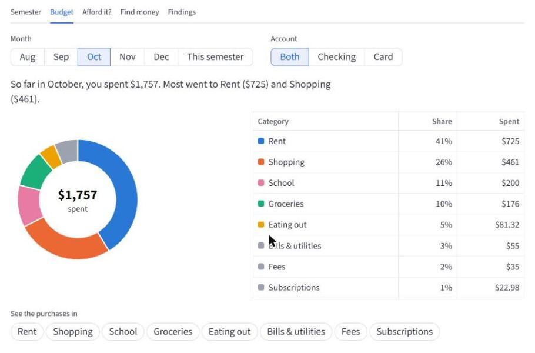
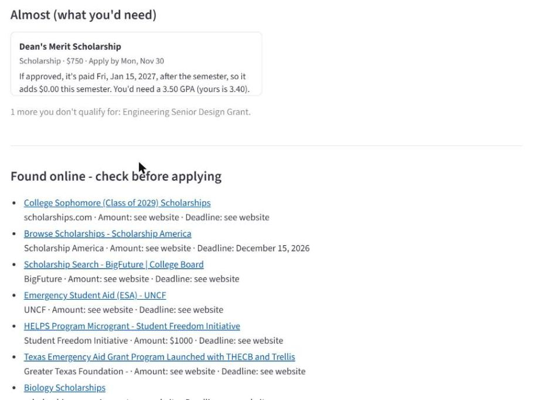
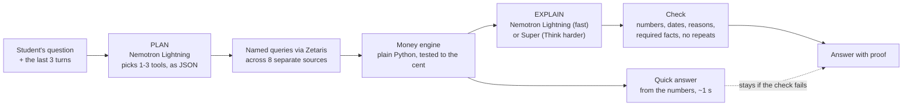

# Runway

**An AI money agent for college students that tells you how long your money lasts, and explains why, with proof.**

Built for the GenAI Works Open Agent Hackathon, Track 2: "The Agent That Can Explain Why".

## The problem

A student's money is split across six places that never talk to each other: a bank account, a credit card, a financial aid award, the school's student account (bursar), a lease and a part-time job. Each one looks fine on its own. Together they hide surprises: a refund held for a missing form, rent landing the day before payday, an overdraft fee, a card bill that falls due right after a big purchase. Students find out when the money is already gone.

## What Runway does

Runway connects eight separate sources (checking, card, financial aid, student account, lease, work schedule, the school's aid opportunities and the meal plan), projects the checking balance day by day to the end of the semester, and answers plain questions. Every answer shows its proof.

**It speaks up first.** Under the status card, a check-in says "Hi Maya. 7 things need your attention." and shows the three most urgent as cards (most money at stake per day until it's due): send the verification form (her $1,850 refund then arrives around Thu, Nov 5), rent on Sun, Nov 1 leaves just $13.32 (rent before payday cost a $35 fee last time), and the $360 card payment on Mon, Nov 9 that takes her below zero; "See all" has the emergency grant to apply for, the tight tuition week, the duplicate music apps and the meal plan. Each card has real actions, and every one is a click by the student:

- **Remind:** a calendar file (.ics) for that deadline, or "Add all deadlines to my calendar" as one file.
- **Email:** opens the drafted email to financial aid in her email app (a `mailto:` link), or copy it. The address is a demo one (`finaid@stateu.example`).
- **Cancel page:** opens the service's official cancel page (Spotify's account page; for Apple Music, Apple's help page).
- **Mark as done:** "Form sent" or "Cancelled Spotify" turns that fix on in the forecast right away (the status card, chart and check-in update) and Runway says what changed in the chat; Undo puts it back. Behind the scenes keeps a log of what Runway prepared and what she approved.

Ask "What should I do this week?" and the answer comes with the same buttons.

**Find money tab.** The school's grants, scholarships and work-study (a separate source), checked against Maya's profile by plain rules: "You may qualify for 3 opportunities worth up to $1,750, plus a work-study job." Cards are grouped by when the money would arrive if approved: the $500 emergency grant (decided in about 3 business days; applying Tue, Oct 27 it would arrive Mon, Nov 2, before she runs out), a $250 book scholarship (Fri, Nov 27), a $1,000 spring scholarship that pays in January (so $0.00 this semester, the same timing lesson as Apple Music), work-study (first paycheck Wed, Nov 18), and the merit scholarship she just misses (3.50 GPA needed, hers is 3.40). Each card drafts the application, sets a reminder, and has an "If approved" switch that adds it to the forecast as a clearly labelled what-if. Grants are never counted as certain money and never used as a fix in "Afford it?".

**Found online - check before applying.** Under the school's list, Runway also shows scholarships and emergency grants found on the web (Firecrawl search, no key needed): title, site and link, and an amount or deadline only when that exact text is on the page, otherwise "see website". Runway never says she qualifies for these, and they are never in the forecast. "Search online now" refreshes them in the background; replay mode uses a set saved on Oct 25 (`demo_answers/web_scholarships.json`). In the chat: "Find me scholarships online".

**Meal plan.** A small card in the Semester tab (and the check-in): her dining dollars run out around Sun, Nov 22, but she'll have about 40 swipes to spare on Dec 18, so checking pays $0.00. Moving 2 dining-dollar meals a week to swipes makes both last.

**Budget tab.** One sentence on where the money went ("So far in October, you spent $1,757. Most went to Rent ($725) and Shopping ($461)."), a donut of the top categories with the total in the middle, and a table whose rows open the purchases behind each category. Month (Aug to Dec, or this semester) and account filters. Below it, "Your budget for November" starts from what's left after rent and bills: for Maya that's $487 short until her refund comes, and $1,363 once the verification form is sent. "Suggest a budget" fills in her usual spending (Shopping $227, Groceries $185, Eating out $96, Transportation $14), scaled down if it doesn't fit; progress bars show this month's pace; and "Use my budget in my forecast" puts the budget into the balance forecast, so the status card and chart show how long the money lasts if she sticks to it. Ask "How much is left in my food budget?" or "What happens if I stick to my budget?" in the chat.

**My data: use your own bank export.** Switch the header to "My data" and upload a CSV from your bank. Runway detects the columns, the date format and how money out is shown (a minus sign, parentheses, or separate debit and credit columns), shows a preview with dropdowns to fix anything, and rejects files it can't read in plain words. Then the whole app runs on your file: the balance today, your pay and bills found from the history, how long the money lasts, the budget and the chat. School features say "Connect your school data to see this." Your file stays on this computer (`user_data/`, never committed), and your answers are never saved.

The demo student is Maya (fictional). Today is Mon, Oct 26, 2026; the semester ends Fri, Dec 18.

| Suggested question | What Runway answers |
|---|---|
| Can I afford a $400 flight home for Thanksgiving if I book it Nov 10? | **Yes, if you do 2 things:** send the verification form (releases a held $1,850 refund around Thu, Nov 5) and cancel Spotify. Cancelling Apple Music saves $0.00, because its next charge is paid on a card bill due after the semester. |
| How long will my money last? | **Your money runs out on Mon, Nov 9**, when a $360 card payment is due. |
| Where is my money leaking? | Two music subscriptions and a $35 overdraft fee from rent, and which of them is worth cancelling. |
| Can I afford a $400 flight home for Thanksgiving? | **Not right now:** with no date, Runway assumes tomorrow, before the refund arrives, and says so. |
| What should I do this week? | **2 things:** send the verification form (the $1,850 refund then arrives around Thu, Nov 5), and keep $725 in checking for rent on Sun, Nov 1, with the same buttons as the check-in. |

**Ask anything about your money, in a chat with follow-ups.** Beyond the suggested questions, Runway answers spending ("How much did I spend on eating out in October?", "How much did I spend at Kroger?"), bills ("What's due next week?"), work ("How many hours did I work in October?"), balances on a date ("What will my balance be on Thanksgiving?"), what's pending today, ways to get money before you run out, and general questions ("What is FAFSA verification?", labelled General info). Follow-ups work: "what about Nov 17 instead?", "why?", "and if I also cancel Apple Music?". A broad request like "Help me get through the semester" runs several checks at once.

- **Fast:** a quick answer built from your numbers appears in about a second; the AI's explanation replaces it a few seconds later, only if it passes the checks. "Think harder" switches to the larger model and shows its reasoning.
- **What-if panel:** turn fixes on and off (send the form, cancel a subscription, pick up an extra shift) and the balance chart and numbers update instantly, with no AI call.
- **Drafted actions:** a ready-to-send email to the financial aid office, calendar reminders and a to-do list. Runway never sends anything; you approve every action with a click.

## Watch the demo

Video: *coming soon* (link to be added)

## Screenshots

Maya's demo data, replay mode.

| | |
|---|---|
|  |  |
| **It speaks up first:** the status card and the check-in, with real actions. | **Yes, if you do 2 things:** every number cited, Apple Music saves $0.00. |
|  |  |
| **Semester:** the balance day by day to Dec 18, and ways to fix it. | **Budget:** where the money went, by category. |
|  | |
| **Find money:** the school's grants, then "Found online - check before applying". | |

## Try it in 2 minutes

No keys needed. This runs the full app on the included data, with the recorded AI answers for the suggested questions. Needs Python 3.11 or newer and git.

**macOS / Linux**

```bash
git clone https://github.com/earg555890/Hackathon1 runway && cd runway
python3 -m venv .venv && .venv/bin/pip install -r requirements.txt
cp .env.example .env
.venv/bin/streamlit run ui/app.py
```

**Windows (PowerShell)**

```powershell
git clone https://github.com/earg555890/Hackathon1 runway; cd runway
py -m venv .venv; .venv\Scripts\pip install -r requirements.txt
copy .env.example .env
.venv\Scripts\streamlit run ui/app.py
```

On Windows, clone into a short folder (like `C:\code`): one package installs files with very long paths, and pip fails past Windows' 260-character limit.

Then open http://localhost:8501 and click a suggested question. Typed questions need a key (below).

On Windows, after the install you can also double-click **Start Runway.bat** (opens the browser; does nothing extra if Runway is already running), **Start Runway (Zetaris).bat** and **Stop Runway.bat**.

**Live answers (NVIDIA key):** put your key from [build.nvidia.com](https://build.nvidia.com) in `.env` as `NVIDIA_API_KEY=...` and set `ANSWER_MODE=cached` (saved answers first, then live) or `ANSWER_MODE=live`. Restart the app. With a key, the check-in's one-line greeting is written by the fast model (checked, never blocking the page); `AI_GREETING=off` keeps the fixed line.

**Zetaris:** start the Zetaris Docker bundle, fill in the `ZETARIS_*` settings and `JAVA_HOME` in `.env`, load the data with `python load_zetaris.py`, then run with `DATA_BACKEND=zetaris`. The first load runs every query on Zetaris (about a minute on our laptop) and caches the results. More in [docs/DEVELOPMENT.md](docs/DEVELOPMENT.md).

## How it works



Trust rules:

- **All math is in code.** The AI never adds, subtracts or projects anything; the engine computes every number before the AI writes a word.
- **Every number is cited.** Each sentence points to a calculation or a source record, and the app shows the rows behind it.
- **A checker reads every answer.** Each dollar amount and date must match the computed results, and the answer must include the facts that matter (like the run-out date). It also checks the reasons: a store or subscription it names must be in the evidence, "charged to your card" must be true, and "saves $X" must match the computed saving. Repeated sentences, cut-off answers and made-up budgets fail too. On a miss, the AI gets one rewrite; if it still fails, the quick answer built from the numbers stays.
- **No internal IDs leak into answers.** Record IDs stay in the proof view, not in the text.
- **It degrades gracefully.** At most two AI calls per question (plus one rewrite). If one model is down, the other writes; if both are down, the quick answer stands. If Zetaris is down, the app runs on the local copy of the data and says so.

## Sponsor technology

- **Zetaris:** federated data access over JDBC (Lightning SQL). Each source is its own Lightning database, 8 in all: `RUNWAY_CHECKING`, `RUNWAY_CARD`, `RUNWAY_AID`, `RUNWAY_BURSAR`, `RUNWAY_LEASE`, `RUNWAY_SHIFTS`, `RUNWAY_OPPORTUNITIES` and `RUNWAY_MEALPLAN`, read through 21 named queries (the app never runs ad-hoc SQL). The federated query `federated_recurring_charges` spans two of those databases in one statement, the checking account and the credit card (`UNION ALL` + `GROUP BY ... HAVING`), to find charges that repeat every month. The app has a "Run live on Zetaris" button that runs it uncached, with a timer and the SQL. An uploaded bank file (My data) can be registered as a ninth database, `RUNWAY_MYDATA`, on the same computer.
- **NVIDIA Nemotron:** two models. PLAN (`nvidia/nemotron-3.5-lightning-30b-a3b`, thinking off) picks up to three tools and their arguments as JSON, and resolves follow-ups. EXPLAIN writes the answer: Lightning with thinking off by default (a few seconds), or `nvidia/nemotron-3.5-super-vl-120b-a12b` with thinking on in "Think harder" mode, where its reasoning trace is shown in the app.

## Results

We asked Runway 10 realistic student questions, 3 times each, with the live models: **30/30 full answers**. Right tool, right verdict, every amount and date matching the records, and every required fact written by the model, with no rewrites. Details: [eval_summary.md](eval_summary.md).

## Data

All demo data is synthetic. Maya Rivera is fictional, and no real bank, card, school or employer account is connected. Her files are in `data/maya/`, generated by `generate_maya_data.py`. The test bank files in `tests/fixtures/fake_bank/` are fake too. A file you upload in My data mode stays on your computer in `user_data/` (gitignored), is never committed or cached, and is sent nowhere except the NVIDIA API for answers you ask for.

## Roadmap

Built already: upload your own bank export (My data). Next:

1. **Bank connections with consent, through an aggregator.** Not built in a 6-day build: it needs the aggregator's approval, a security review, and real consent and privacy work, so the CSV upload covers this for now.
2. **School integrations (financial aid, student account, meal card), through university partnerships.** Not built in a 6-day build: there are no standard APIs for aid or bursar accounts, so each school needs its own agreement.
3. **Verified scholarship databases,** so "Found online" results can say who qualifies, with checked amounts and deadlines.
4. **A mobile app,** with the check-in as a weekly notification.

---

Developer notes (setup, tests, evaluation, Zetaris loading): [docs/DEVELOPMENT.md](docs/DEVELOPMENT.md).
